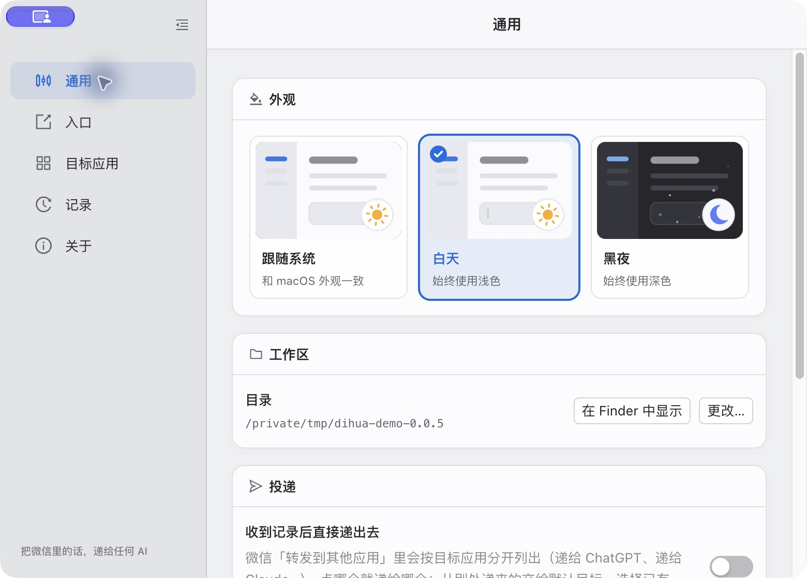
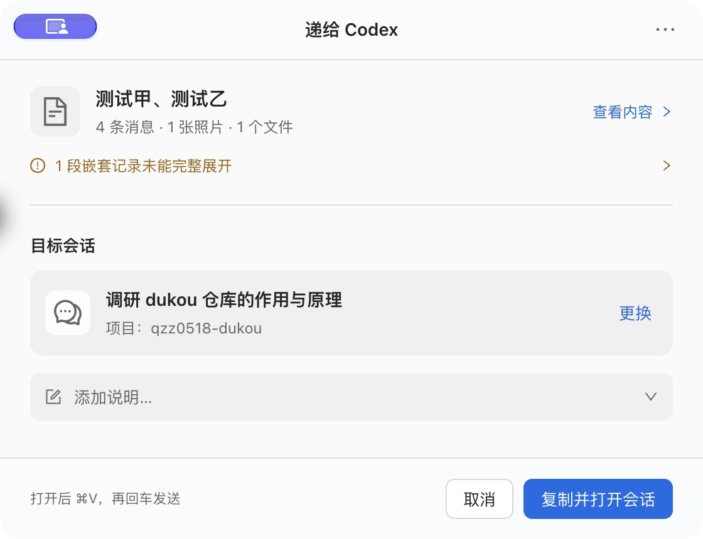
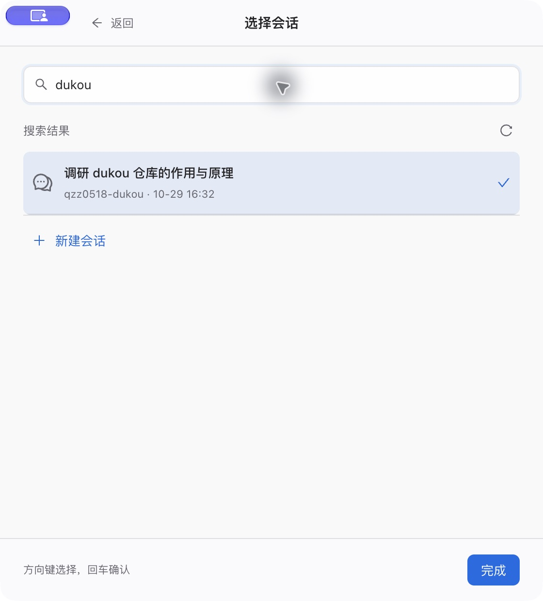
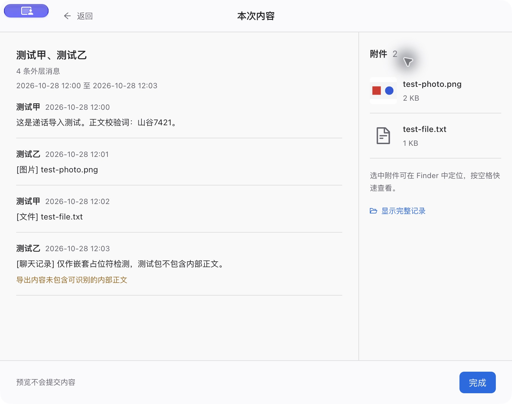
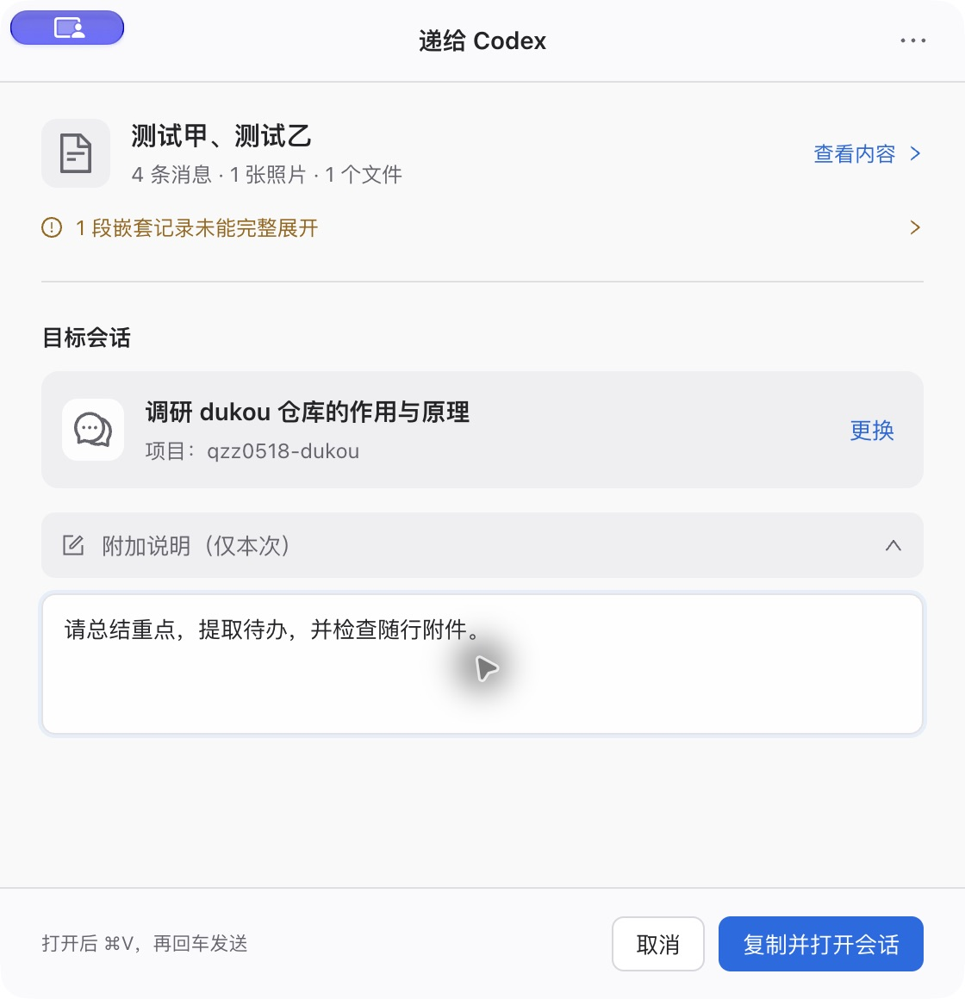
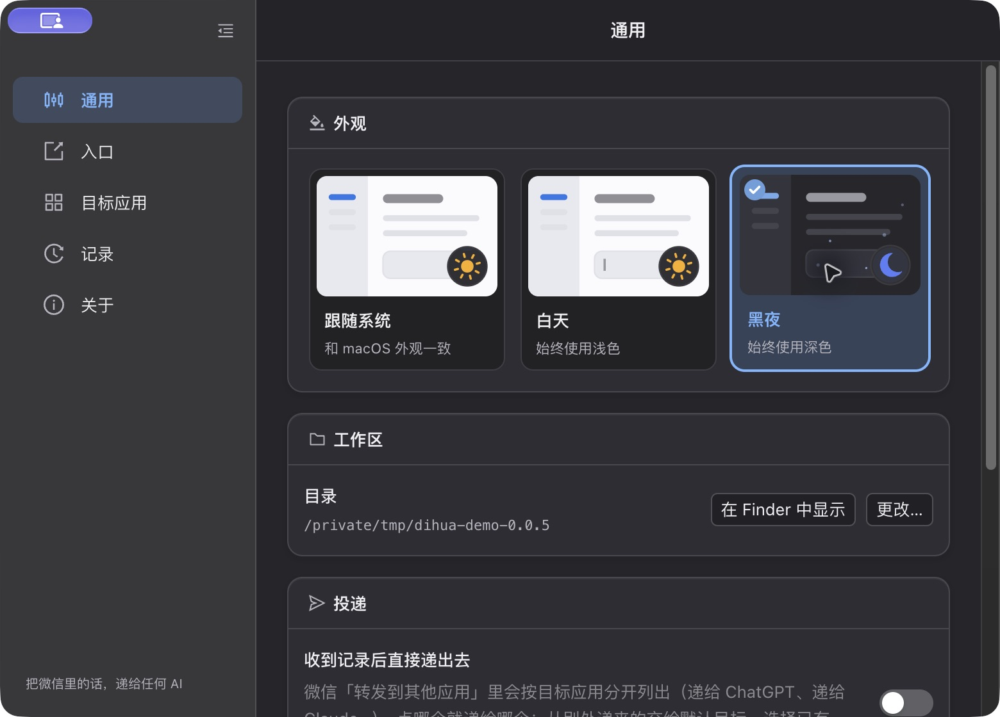
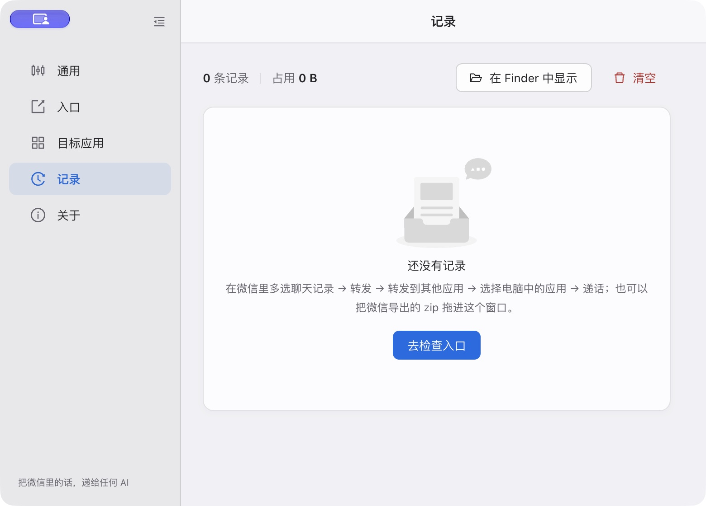
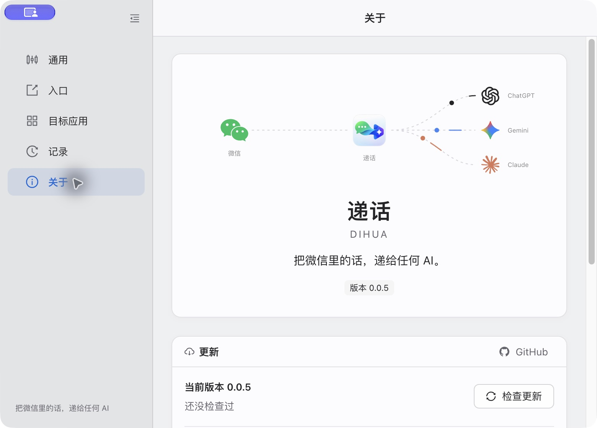
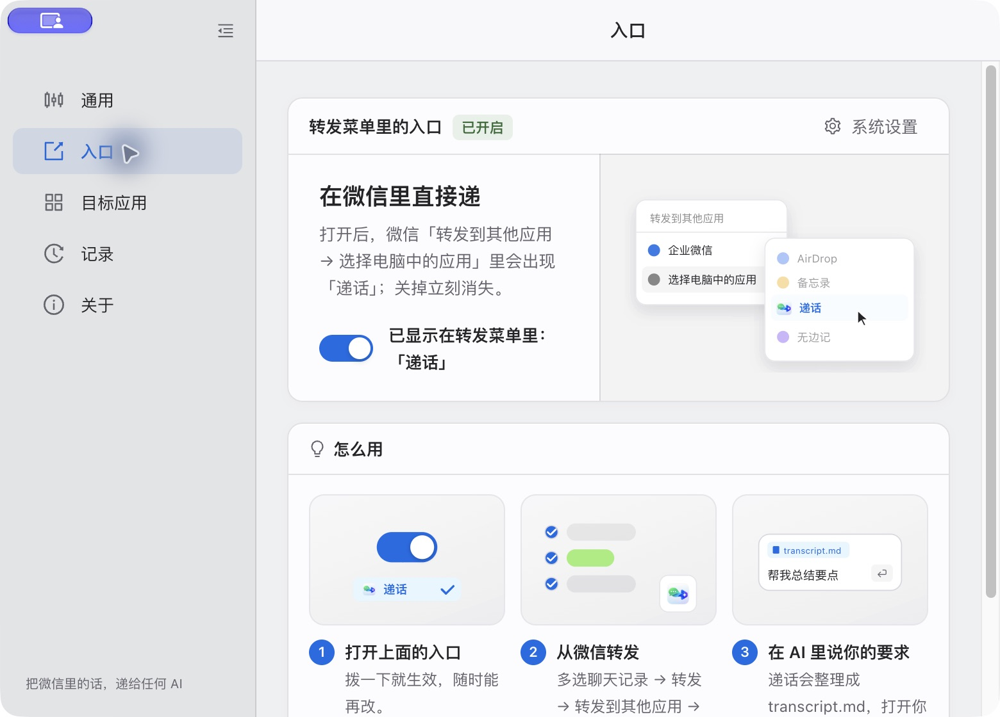
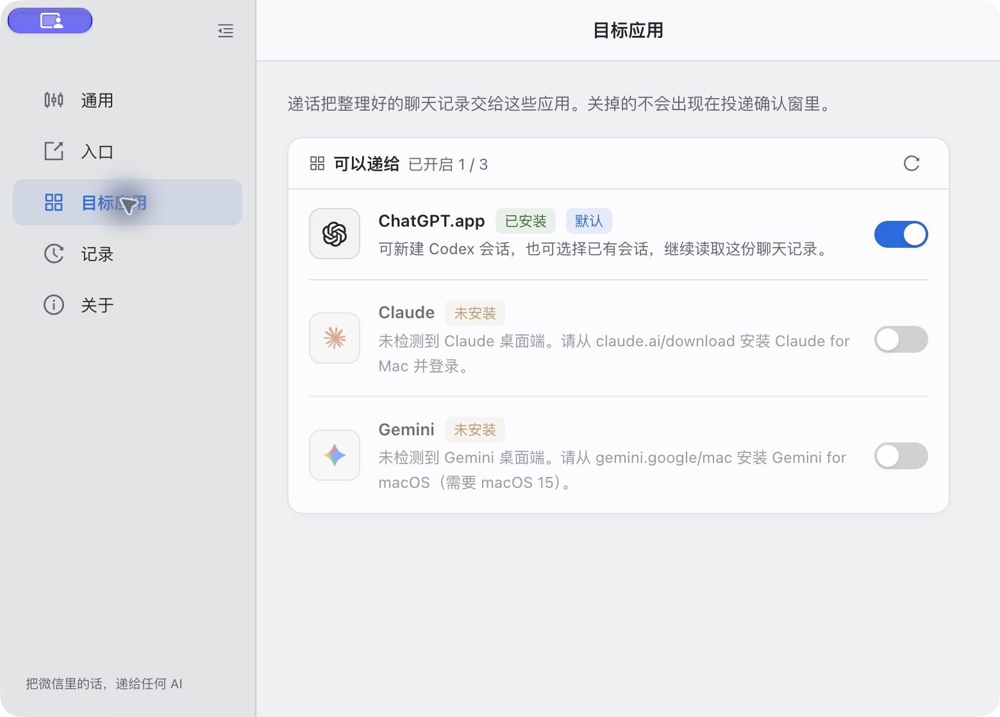

<p align="center">
  
</p>

<h1 align="center">递话 · Dihua</h1>

> 首先感谢 [ZHlovecat/dihua](https://github.com/ZHlovecat/dihua) 原项目及作者 [@ZHlovecat](https://github.com/ZHlovecat) 的开源工作。微信共享入口、导出包整理和多 AI 应用交接均建立在原项目之上。本仓库是社区增强 fork，重点改进 Codex 会话选择、嵌套记录解析与转发确认体验，并保留原作者的 MIT 许可与版权声明。

<p align="center">
  <b>把微信里的话，递给任何 AI。</b><br>
  在 Mac 微信里多选消息、转发给递话，将文字、图片和文件整理后交给 Codex、Claude 或 Gemini。
</p>

<p align="center">
  <a href="README.md">English</a> · <b>简体中文</b>
</p>

<p align="center">
  <a href="https://github.com/zhnq/dihua/releases"></a>
  
  <a href="LICENSE"></a>
</p>

## 下载 0.0.5

**[下载 Apple Silicon 安装包（arm64 DMG）](https://github.com/zhnq/dihua/releases/download/v0.0.5/Dihua-0.0.5-arm64.dmg)** · [0.0.5 发布说明](https://github.com/zhnq/dihua/releases/tag/v0.0.5) · [SHA-256 校验文件](https://github.com/zhnq/dihua/releases/download/v0.0.5/Dihua-0.0.5-arm64.dmg.sha256)

适用于 macOS 13 及以上的 Apple Silicon Mac。**本次 Release 仅提供 arm64 安装包，暂未提供 Intel x64 版本。** 安装步骤见[安装](#安装)。

## 基于原项目做了哪些改进

原项目提供了从微信共享、解压导出包、整理本地工作区到交给多个 AI 应用的完整流程。0.0.5 重点统一了主窗口与分享弹窗的毛玻璃材质，并修复目标菜单的 Esc 操作。以下汇总本 fork 相对原项目的增强：

| 改进 | 0.0.5 中的行为 |
|---|---|
| **统一毛玻璃界面** | 通用、入口、目标应用、记录、关于与分享弹窗共用材质、字体和控件层次；适配深浅色、窄窗口及减少透明度设置。 |
| **指定已有 Codex 会话** | 搜索会话、选择最近会话或新建会话；向已有会话交接时，将本批记录独立复制到其工作目录。 |
| **保留嵌套聊天记录** | 递归识别微信导出中的缩进层级，保留内部时间、发言人和附件关联；分别统计外层与内层消息。 |
| **重做转发确认窗** | 内容摘要和目标会话优先显示，搜索与预览按需展开；支持键盘选择、⌘Enter、深色外观与减少动态效果。 |
| **本次附加说明** | 可在转发时补充总结、提取待办等要求，与本批提示词一起交接，不保存为默认任务。 |
| **内容和附件预览** | 查看消息层级、真实图片缩略图与文件列表；在 Finder 中定位附件后可按空格快速查看。 |
| **准确的交接状态与恢复** | 区分待粘贴和已排队；重新复制、打开目标不会重复提交。缺失正文和解析限制会明确提示。 |

已有会话默认使用「复制并打开会话」，由你粘贴、检查后发送。「直接发送到会话」保留为转发选项中的实验功能。详细要求、文件位置与失败处理见 [Codex 会话使用说明](docs/codex-conversations.md)。

## 新版界面

以下为 0.0.5 的实际截图，使用独立的演示数据环境，聊天内容为合成测试数据。黄色提示演示的是导出包只包含嵌套占位符、没有内部正文的情况。

**统一的主窗口：柔和玻璃底层与清晰的内容卡片。**

<p align="center">
  
</p>

**紧凑确认窗：先确认内容和目标，再执行交接。**

<p align="center">
  
</p>

<details>
<summary>查看更多界面：会话搜索、内容预览与附加说明</summary>

**搜索已有 Codex 会话，也可以新建会话。**

<p align="center">
  
</p>

**按需展开本次内容，核对图片、文件与内容提示。**

<p align="center">
  
</p>

**附加说明只用于本次交接。**

<p align="center">
  
</p>

</details>

<details>
<summary>查看更多主窗口：深色外观、记录与关于页</summary>

**深色外观沿用相同的材质与阅读层次。**

<p align="center">
  
</p>

**记录页：可以从微信转发，也可以拖入导出的 ZIP。**

<p align="center">
  
</p>

**关于页：版本、更新和文件位置集中查看。**

<p align="center">
  
</p>

</details>

## 为什么要有递话

<p align="center">
  
</p>

Mac 微信（4.1.13 及以上）可以通过「转发到其他应用」将所选消息导出成 zip。递话通过 macOS 共享扩展接收导出包，在本地整理消息和附件，再交给目标 AI 应用，省去手动解压和归整文件的步骤。

- **从微信直接开始。** 多选 → 转发 → 转发到其他应用 → 递话，然后确认目标。
- **AI 真的读得到。** zip 被整理成本地工作区：`transcript.md` 保留消息顺序、发言人与嵌套层级，图片和文件另存，`meta.json` 记录概况。每个目标应用按其支持的方式接收。
- **要做什么由你说。** 可以在确认窗填写本次要求，也可以到目标 AI 应用中继续补充。已有 Codex 会话默认由你粘贴、检查并发送。
- **不经递话上传任何东西。** 没有账号、没有服务器、没有埋点。AI 应用照旧和它们自己的后台通信。

## 怎么用

<p align="center">
  
</p>

1. **打开入口。** 递话注册了一个 macOS 共享扩展，微信「转发 → 转发到其他应用 → 选择电脑中的应用」里就会列出它。
2. **从微信转发。** 多选任意消息——文字、图片、视频、文件——转发给「递话」。

   <p align="center">
     
   </p>

3. **确认目标。** 在新版确认窗中核对摘要，选择 Codex 会话，需要时展开预览或填写附加说明。
4. **交接并发送。** 已有 Codex 会话点击「复制并打开会话」，进入目标会话后按 ⌘V、检查内容，再回车发送。新建会话和其他目标按完成页提示继续操作。

原有「收到记录后直接递出去」仍可用于新建会话和其他目标；选择已有 Codex 会话时，每次都会显示确认窗。

## 转发确认窗

默认显示内容摘要和目标会话；预览、会话搜索、附加说明及转发选项按需展开。Codex 可选择最近会话、搜索已有会话或新建会话。搜索列表支持方向键和回车，Esc 返回；目标应用菜单展开时 Esc 只关闭菜单，不取消本批记录；附加说明中可按 ⌘Enter 执行交接。

已有会话默认「复制并打开会话」，由你粘贴、检查并发送。实验性的直接发送位于「转发选项」中。交接状态区分待粘贴和已排队，支持重新复制及打开目标，不会因此再次提交请求。附加说明只用于本次交接；原有批次内容不被改写。预览保留嵌套层级、显示随行附件，点击附件可在 Finder 定位后按空格快速查看。

## 嵌套聊天记录

微信导出正文中用缩进表示的「聊天记录里的聊天记录」会递归展开，并在 `transcript.md` 中用引用层级保留转发关系、内部时间和发言人。内层图片和文件也会关联到整理后的附件。

消息条数按外层统计，内层条数单独显示；`transcript.json` 保存完整的结构化解析结果，`meta.json` 保存嵌套统计。只有占位符、内部条数不符或超过 16 层解析上限时，会保留导出原文并提示限制。微信没有导出的正文无法恢复，可在微信打开内层记录，将内部消息另行转发。格式识别成功不代表内容完整。

此修复适用于重新导入的批次；旧批次不会自动改写。

## 支持的目标应用

| 目标 | 记录怎么到它手里 |
|---|---|
| **Codex（ChatGPT 桌面端）** | 新建会话并预填提示词，或选择已有会话、复制记录到其工作目录；由 Codex 读取 `transcript.md` 及附件。 |
| **Claude 桌面端（Cowork）** | 新建一个 Cowork 任务，工作区目录挂上、提示词预填好。 |
| **Gemini 桌面端** | 把 `transcript.md` 和最多 9 个图片/文件作为附件放进输入框，提示词复制到剪贴板，粘贴即发。 |

<p align="center">
  
</p>

## 安装

1. 下载 [Dihua-0.0.5-arm64.dmg](https://github.com/zhnq/dihua/releases/download/v0.0.5/Dihua-0.0.5-arm64.dmg)，打开后将 *Dihua.app* 拖进「应用程序」。
2. 安装包采用 ad-hoc 签名，尚未经过 Apple 公证。如果首次打开被系统拦截，请确认下载来源后，按 macOS 的安全提示手动允许打开。
3. 启动一次递话，它会自动登记共享入口；微信菜单里若还没出现，到「系统设置 → 通用 → 登录项与扩展 → 扩展 → 共享」里打开「递话」。

**要求：** macOS 13 Ventura 及以上 · Mac 微信 4.1.13 及以上 · ChatGPT / Claude / Gemini 桌面端至少装一个。

选择已有 Codex 会话还需要本机可用的 Codex CLI；新建会话无需 CLI。详见[使用说明](docs/codex-conversations.md#要求与文件位置)。

如需校验安装包，将 [DMG](https://github.com/zhnq/dihua/releases/download/v0.0.5/Dihua-0.0.5-arm64.dmg) 和 [校验文件](https://github.com/zhnq/dihua/releases/download/v0.0.5/Dihua-0.0.5-arm64.dmg.sha256) 下载到同一目录，在该目录运行：

```sh
shasum -a 256 -c Dihua-0.0.5-arm64.dmg.sha256
```

**更新：** 「关于 → 检查更新」读取[本仓库的 Releases](https://github.com/zhnq/dihua/releases) 并给出下载链接；启动时每天最多自动查一次，有新版本会通知你。

## 磁盘上有什么

```
~/Documents/dihua/
└── inbox/20260907-231000-项目群/
    ├── transcript.md     # 保留消息顺序、发言人、嵌套层级与附件链接
    ├── transcript.json   # 结构化消息与嵌套关系
    ├── meta.json         # 条数、时间范围、解析置信度与嵌套统计
    ├── 媒体/             # 图片与视频（视频另有 .thumb.png 缩略图）
    ├── 文件/             # 其他随行附件
    └── 原始/             # 微信导出的原始 zip 与 txt
```

每条记录都列在递话的「记录」里，可以再递一次、在 Finder 中显示、或连文件一起删除；自动清理时长可设。

## 致谢

感谢原项目 [ZHlovecat/dihua](https://github.com/ZHlovecat/dihua) 及作者的开源贡献，也感谢 [LINUX DO](https://linux.do/) 社区的支持与反馈。原始许可与版权声明保留在 [LICENSE](LICENSE) 中。

## 许可

[MIT](LICENSE) © 2026 zhanghang
